<div align="center">

**码上面试平台** - 基于大语言模型的简历分析、模拟面试服务

**[官网 / 商业 SaaS](https://chrionai.icu/) · [服务场景](#服务场景) · [版本与源码学习](#开源版商业-saas-与源码学习)**


[](https://openjdk.org/)
[](https://spring.io/projects/spring-boot)
[](https://www.mysql.com/)
[](https://redis.io/)
[](https://vuejs.org/)


</div>

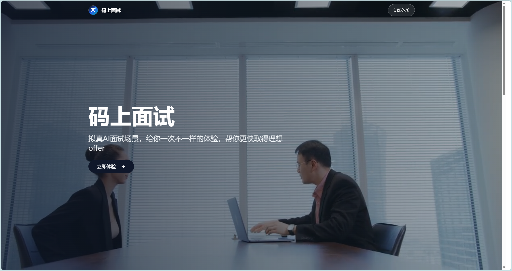

这是一个基于 Spring Boot 3 + Java 17 + Spring AI + MySQL + Redis 构建的 AI 文字模拟面试后端项目，聚焦「上传简历 → 生成题目 → 逐题回答 → 评分与追问 → 复盘报告」主流程，并保留一个 DeepSeek 普通文字聊天入口。模型直连 DeepSeek，正式数据收敛到 MySQL，Redis 仅保留会话锁、限流与登录态。前端已用 Vue 3 重写（见 [frontend](../frontend)）。

> 说明：本仓库已完成一轮架构重构（见 `docs/文字面试平台重构实施计划.md` 与 `docs/P0~P6-实施记录.md`）：移除了语音/神态分析、通用 Agent（星辰工作流）、MongoDB 与 WebSocket 端点，出题/评分/追问改为直连 DeepSeek，正式数据收敛到 MySQL。README 下文「功能特性/技术栈」已同步为重构后的现状，历史版本能力见 `docs/legacy/`。

演示视频：[Bilibili 项目展示]( https://www.bilibili.com/video/BV1ccR9B9EEm/?share_source=copy_web&vd_source=2147a1677cc5a940112d07c6f03c4bc9)

前端仓库链接：https://github.com/lishuangqiang/AI-Meeting-Frontend

后端仓库链接：https://github.com/lishuangqiang/AI-Meeting/tree/main

## 官网与商业 SaaS

**[访问官网 / 进入商业 SaaS → https://chrionai.icu/](https://chrionai.icu/)**

AI-Meeting（码上面试平台）是我们项目的开源前身。在此基础上，我们持续迭代了 **Chiron Agent 商业 SaaS**，将简历整理、岗位评估、模拟面试和复盘串成完整的求职准备流程。

希望直接使用产品，可以访问官网；希望学习 AI 应用开发，可以从本仓库入手，也可以联系我们了解商业 SaaS 源码学习。

### 服务场景

以下是 Chiron Agent 商业 SaaS 面向的主要场景，具体可用功能以线上版本为准；本开源仓库的能力见下方「功能特性」。

| 场景 | 可以做什么 |
| --- | --- |
| 校招 / 实习准备 | 整理简历，围绕项目经历进行模拟面试，通过逐题反馈发现表达和知识薄弱点。 |
| 社招 / 跳槽准备 | 结合简历与目标岗位 JD 评估匹配情况、能力缺口与风险，明确准备重点。 |
| 面试训练与复盘 | 练习回答和追问，查看评分、反馈与复盘报告，持续调整后续训练方向。 |
| 简历与能力梳理 | 维护简历材料，结合岗位评估和面试记录积累能力画像，为下一次投递做准备。 |

## 开源版、商业 SaaS 与源码学习

### 免费开源版

**本仓库的代码与配套学习文档继续免费开放，代码遵循 [MIT 许可证](LICENSE)。** 适合学习 Spring Boot、Spring AI、模拟面试业务、SSE 流式响应、MySQL 幂等提交与乐观锁，以及在理解实现后用于个人项目实践或毕设研究。

项目由我和程序员海豚共同完成，感谢参与建设的朋友。我们保留这份开源项目和学习资料，方便大家从基础设施、核心业务到项目复盘逐步学习。

领取本开源项目的飞书学习文档，可添加微信：**JavaAndGo8888** 或 **hqy2004hw**。

### 商业 SaaS 在线服务（付费）

**服务地址：[https://chrionai.icu/](https://chrionai.icu/)**

面向希望直接进行求职准备的用户，提供在线使用的简历、岗位评估、模拟面试与复盘服务，无需自行部署项目。商业 SaaS 持续独立迭代，其功能范围与本开源仓库不同。

商业 SaaS 为付费在线服务。具体开通方式、价格、使用额度与服务范围，请通过官网了解或添加微信 **hqy2004hw** 咨询。

### 商业 SaaS 源码学习（付费）

面向希望进一步学习完整商业 AI 产品实现的开发者，了解从开源面试项目演进到商业 SaaS 的工程实践，包括前后端协作、Agent 运行、岗位评估与面试业务闭环等。

**商业 SaaS 源码学习 / 费用咨询：微信 `hqy2004hw`**

添加时请备注：**商业 SaaS 源码学习**。

商业版源码的交付内容、学习费用与授权范围以双方确认为准，商业版源码不适用本开源仓库的 MIT 许可。

## 系统架构：
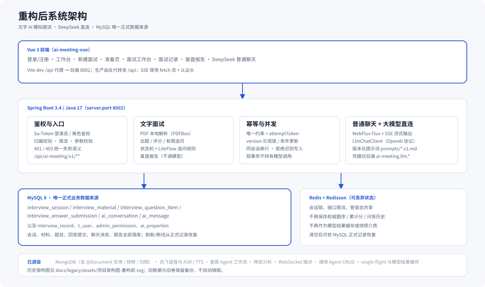

## 功能特性

### 模拟面试模块

- **简历驱动出题**：上传简历后，文本型 PDF 由 PDFBox 本地抽取文本；扫描版 PDF 与图片简历（PNG/JPG/WebP/BMP）走视觉模型 OCR（`ai-meeting.vision.*`，默认千问 `qwen3.8-omni-flash`）。抽取文本后由 DeepSeek 按版本化提示词（`resources/prompts/interview/*.v1.md`）生成结构化面试题、简历评分与候选人可见的改进建议。视觉模型密钥未配置时，文本 PDF 流程不受影响，仅扫描件/图片提示配置 `VISION_API_KEY`。
- **逐题评分与有限追问**：答题后由 DeepSeek 同步返回 0–100 分与反馈，LiteFlow 规则链裁决是否追问；追问围绕当前回答缺口展开，追问分数单独展示、不计入主问题平均分。
- **请求幂等与并发保护**：以 MySQL 唯一约束 + `attemptToken` + `version` 乐观锁保障「同题至多一个有效提交」，同会话操作串行，杜绝重复扣费与迟到写入。
- **状态落库可恢复**：会话、材料、题目、回答提交、聊天会话/消息全部落 MySQL，刷新/断线后从正式记录恢复当前题与进度。
- **问答回放与复盘报告**：面试结束后生成结构化报告，包含面试分/简历分/综合指数、能力维度、逐题回放（问题 → 回答 → 分数 → 反馈）与 AI 综合建议。
- **面试记录管理**：分页查询历史面试记录，按会话查看完整报告与评分详情。

### AI 对话模块

- **DeepSeek 直连**：普通文字聊天固定走服务端 `ai-meeting.llm.*` 配置直连 DeepSeek（`deepseek-chat`），凭据只存后端环境，前端不接触 Key。
- **SSE 流式响应**：基于 WebFlux Flux + SSE 实现打字机式流式输出，支持 DeepSeek `reasoning_content` 思维链展示。
- **会话管理**：支持创建、分页查询、结束、删除对话，消息持久化至 MySQL，支持历史消息回溯。

### 用户与权限模块

- **Sa-Token 认证**：基于 Sa-Token 实现登录 / 注册 / 登出，Token 持久化至 Redis 支持多实例共享登录态。
- **角色权限控制**：支持管理员角色分配，管理员接口通过 `@SaCheckRole` 注解鉴权。

## 简历写法

> 以下按重构后的实现整理，可直接作为项目经历参考；已移除的语音/神态/星辰/单飞机制不再列入。

1. 负责 AI 面试答题主链路设计，基于版本化提示词直连 DeepSeek 完成出题、评分与追问，结合 EnumMap 状态机 + LiteFlow 规则链实现追问裁决与流程推进；以 MySQL 唯一约束 + `attemptToken` + `version` 乐观锁保障「同题至多一个有效提交」，替换原先的 Redis 分布式去重与结果缓存。
2. 主导面试长会话状态治理重构，将核心数据（会话、材料、题目、回答提交、聊天会话/消息）统一收敛到 MySQL 作为唯一正式来源，Redis 仅保留会话锁、限流与登录态等可丢弃状态；刷新与断线后从正式记录恢复当前题与进度，不再依赖多源快照对账。
3. 设计提交幂等与并发保护：以 `requestId` 区分重试、`inputHash` 校验请求冲突、条件更新拒绝迟到执行者，答题与结束/恢复竞争由会话互斥与终态检查兜底；模型调用不持有数据库事务，失败按阶段保留可重试状态，不伪造成功。
4. 实现复盘报告：区分 null 与 0 分、统计有效评分覆盖率、主问题与追问评分分离、报告打开不再次调用模型；雷达权重去掉神态轴后归一化为简历 31.25% / 面试 68.75%。
5. 设计并推动面向 AI Coding 的 Skill 业务知识体系，将分散、过时、不可持续维护的传统文档升级为可被 Code Agent 直接消费的模块化业务知识单元，解决复杂业务开发中的知识断层与隐性规则丢失问题。

## 文档展示

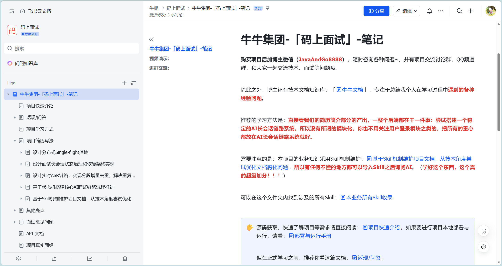
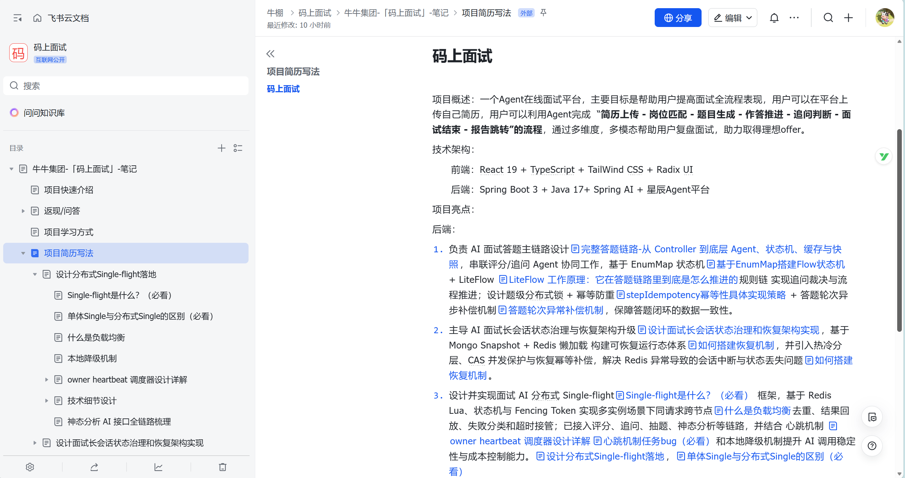

## 技术栈

### 后端技术

| 技术 | 版本 | 说明 |
| --- | --- | --- |
| Java | 17 | 开发语言 |
| Spring Boot | 3.4.4 | 应用框架 |
| Spring AI | 1.0.0 | AI 集成框架，DeepSeek 直连 |
| MyBatis-Plus | 3.5.9 | ORM 持久层框架 |
| MySQL | 8.0 | 唯一正式业务数据来源 |
| Redis + Redisson | 3.21.0 | 会话锁、接口限流、登录态 |
| Sa-Token | 1.39.0 | 权限认证框架，集成 Redis 共享登录态 |
| Resilience4j | 2.2.0 | 熔断、限流、重试、舱壁隔离 |
| LiteFlow | 2.15.3.2 | 规则引擎，驱动追问裁决等业务规则链 |
| PDFBox | 3.0.5 | 简历 PDF 本地文本抽取与扫描件渲染 |
| 视觉模型 | qwen3.8-omni-flash | 图片/扫描件 OCR，OpenAI 兼容多模态协议，凭据经 `VISION_API_KEY` 注入 |
| SSE | - | AI 流式响应 |
| Maven | 3.9.x | 构建工具 |

> 存储职责：MySQL 是唯一正式业务数据来源（会话、材料、题目、提交、聊天、报告）；Redis 仅保留会话锁、接口限流与登录态等可丢弃状态，不再作为权威业务状态。


### 运维与部署

| 技术 | 说明 |
| --- | --- |
| Docker Compose | 容器化一键部署（MySQL + Redis + 应用，前端 `dist/` 反代 `/api`） |
| GitHub Actions | CI 流水线，自动执行单元测试与构建 |

### 前端技术
| 技术 | 版本 | 说明 |
| --- | --- | --- |
| Vue | 3.5 | UI 框架 |
| TypeScript | 5.6 | 开发语言 |
| Vite | 5.4 | 构建工具 |
| Vue Router | 4.5 | 路由管理 |
| Pinia | 2.3 | 全局状态管理 |
| Element Plus | 2.9 | 基础组件库 |
| Axios | 1.7 | HTTP 请求 |

> 当前 Vue 前端位于 `../frontend/`，仓库统一入口和启动说明见 [根目录 README](../README.md)。旧 React 工程不纳入本仓库。

## 测试与 CI

统一校验入口：

```bash
# 后端（admin 单模块）：clean verify 已含 spotless 格式校验 + 全量单元测试
./mvnw -B -ntp clean verify

# 前端（../frontend）
npm run typecheck
npm test        # vitest，纯逻辑与 HTTP 契约单测
npm run build
```

当前 CI（`../.github/workflows/backend-ci.yml`）覆盖：

- JDK 17 下执行 `clean verify`：Maven 构建、spotless 格式校验与全量单元测试（不跳过测试）
- CI 通过 `services` 提供 MySQL 8.4 / Redis 7.2，供启动 Spring 上下文的健康检查使用；不需要导入业务 DDL

工作流文件见 [后端 CI](../.github/workflows/backend-ci.yml) 与 [前端 CI](../.github/workflows/frontend-ci.yml)。

## 效果展示

### 简历与面试

首页登录：


上传简历：

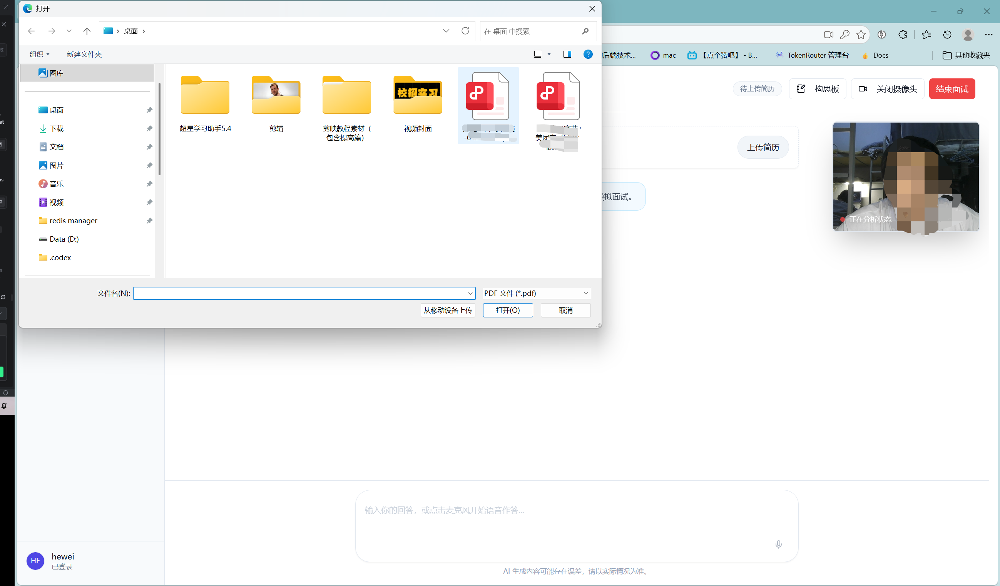

在线解析并出题：

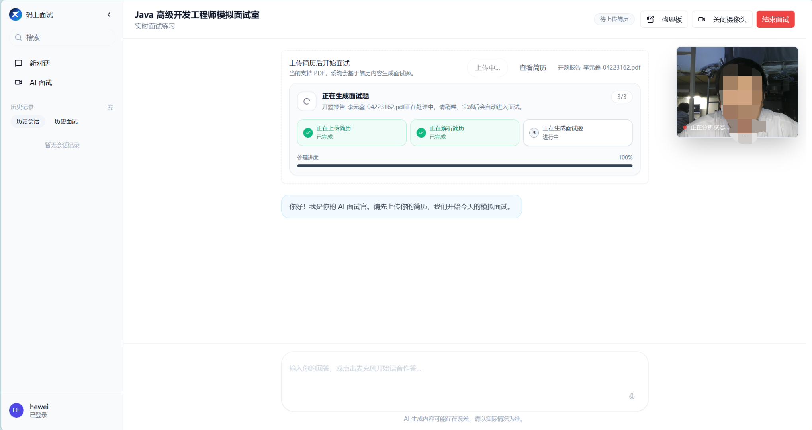

面试入口：

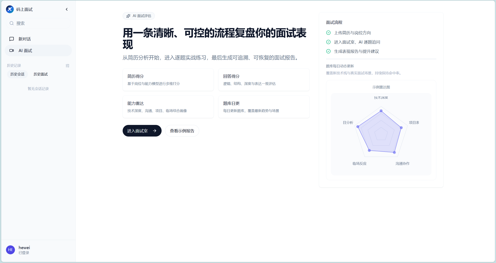

提问环节：

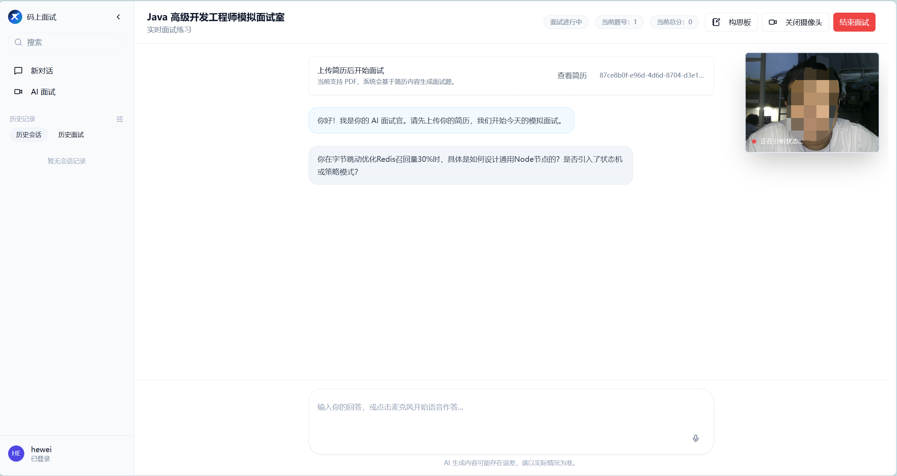

追问环节：

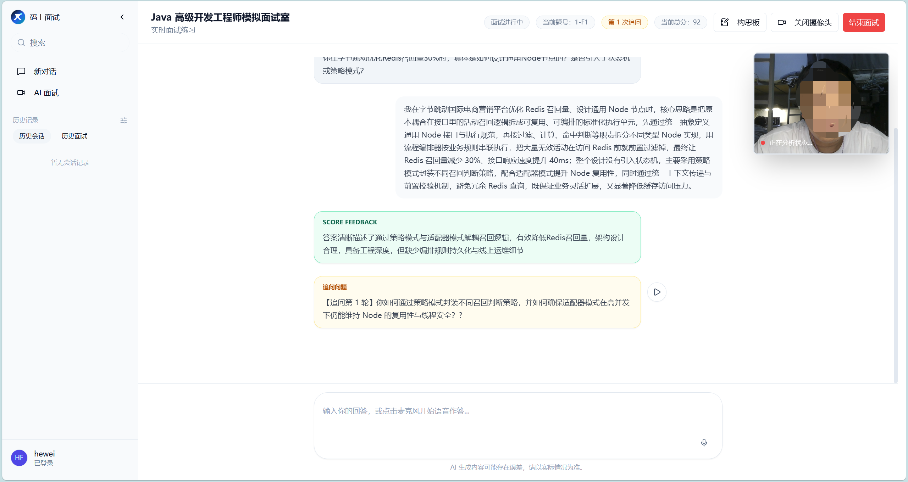

结果复盘：

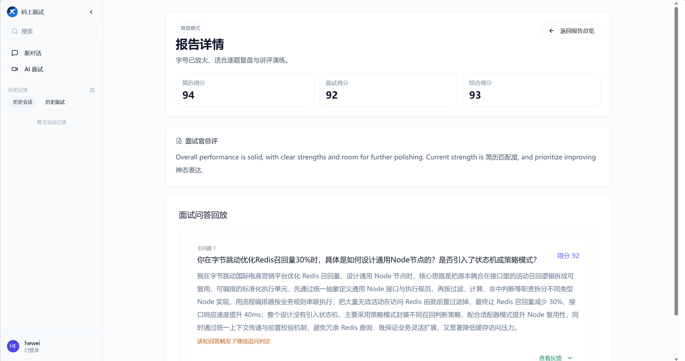

面试结果分析：

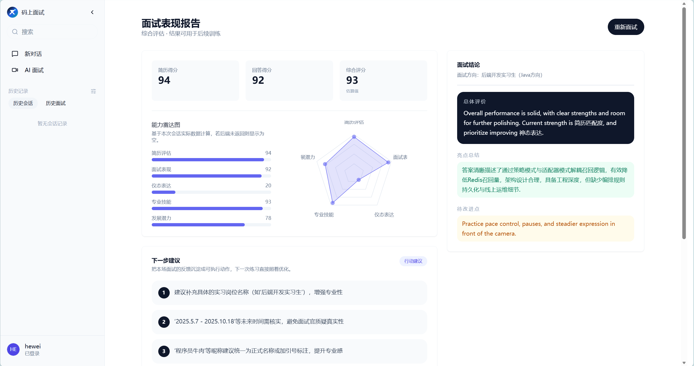


## 开源协作

- 许可证：[MIT](LICENSE)
- 贡献指南：[CONTRIBUTING.md](CONTRIBUTING.md)
- 行为准则：[CODE_OF_CONDUCT.md](CODE_OF_CONDUCT.md)
- 安全说明：[SECURITY.md](SECURITY.md)

## 发布说明与部署

本轮重构已将语音/神态/通用 Agent（星辰）、MongoDB 与 WebSocket 端点移除，出题/评分/追问改为直连 DeepSeek，正式数据收敛到 MySQL，前端改为 Vue 3。历史能力见 `docs/legacy/`，分阶段实施记录见 `docs/P0~P6-实施记录.md`。

**凭据与部署**：真实密钥不入库。后端凭据从环境变量或 `admin/application-local.yaml`（已 gitignore）注入；一键部署请复制 `.env.example` 为 `.env` 并填入 `LLM_API_KEY`，然后执行 `docker compose up -d --build`。Docker 初始化会自动建 `interview_core.sql` 中的 6 张核心表，无需手工导 SQL。前端生产用 `dist/` 反代 `/api` 到后端 8002。

**视觉模型（可选）**：图片简历与扫描版 PDF 需要视觉模型 OCR。地址已预置为阿里云百炼的 OpenAI 兼容端点 `https://dashscope.aliyuncs.com/compatible-mode/v1`（可用 `VISION_BASE_URL` 覆盖），**只需在 `.env` 填 `VISION_API_KEY`**（或本地 `admin/application-local.yaml` 的 `ai-meeting.vision.api-key`）即可启用。留空时应用照常启动，文本型 PDF 流程完全不受影响；仅当上传图片/扫描件时提示配置密钥。本地直连可用环境变量：

```bash
# 公共端点（推荐）：模型名必须用该端点上存在的多模态模型
VISION_BASE_URL=https://dashscope.aliyuncs.com/compatible-mode/v1
VISION_MODEL=qwen-vl-max-latest
VISION_API_KEY=<在此填入你的密钥>

# 若使用业务空间专属域名，则形如（{WorkspaceId} 在百炼控制台可查）：
# VISION_BASE_URL=https://{WorkspaceId}.cn-beijing.maas.aliyuncs.com/compatible-mode/v1
```

> **两个都改，不能只改一个。** 旧的 `cn-beijing.maas.qianwenapi.com` 已无法解析（DNS 返回 Non-existent domain），继续使用会得到 `I/O error on POST request ...` 而没有任何 HTTP 状态码；换到公共端点后若仍用 MaaS 私有别名 `qwen3.8-omni-flash`，则会变成 `400 model_not_found`。

**历史数据**：旧 Mongo 卷不自动删除；如需迁移请先盘点并另行制定维护窗口方案。旧 React 工程已移出项目目录，当前仅维护 Vue 前端。
